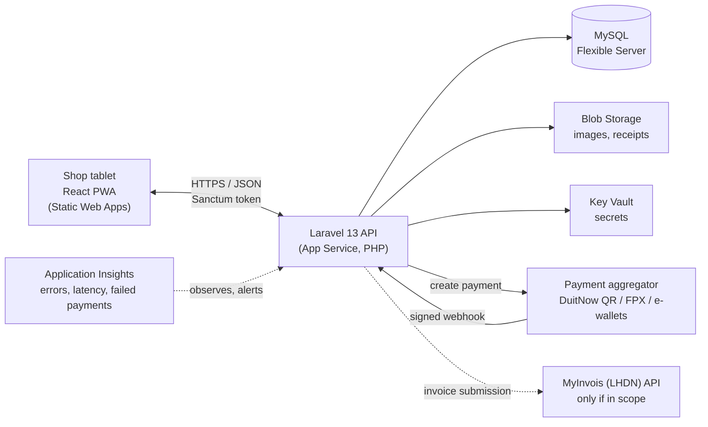
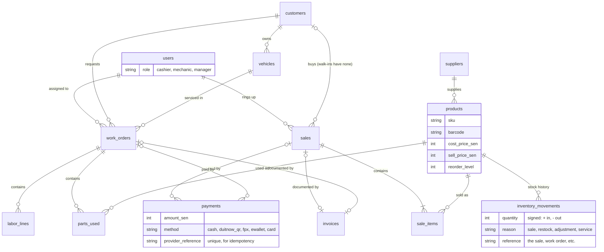
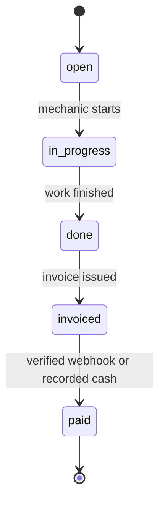
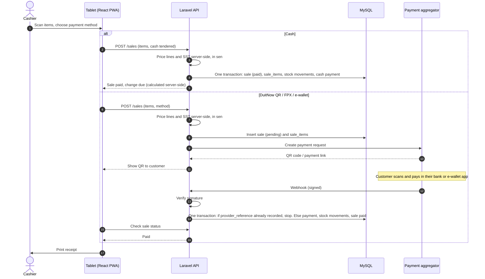

# DESIGN.md — Architecture & Decisions

A living design document. Update it whenever a decision changes. It holds the *why*;
CLAUDE.md holds the day-to-day conventions and commands.

---

## Confirmed decisions (2026-08-28)

1. **MyInvois e-invoicing scope** — Required only if shop turnover is at/above RM1M (RM1m–RM5m
   band enforced from Jan 2027, soft launch through 2026). Below RM1M is currently exempt.
   *Plan:* design the invoice layer to be MyInvois-ready regardless; wire up API submission
   only if in (or approaching) scope.
2. **Offline resilience** — Online-first with a degraded local cart that queues the sale and
   syncs when the connection returns. Not full offline-first for v1.
3. **Payment provider** — A local aggregator (HitPay / Billplz / Fiuu / Curlec) exposing
   DuitNow QR + FPX + e-wallets through one API, with in-person POS support. Cash is a
   first-class method.
4. **Hardware** — Thermal ESC/POS receipt printer, USB keyboard-wedge barcode scanner,
   optional cash drawer triggered by the printer.

---

## System overview

Diagrams in this file are [Mermaid](https://mermaid.js.org/) — GitHub renders them; edit them as text.

The React PWA is the only client. The Laravel API is the only thing that touches the database,
money, and auth. Payment confirmation arrives via a server-to-server webhook, never the browser.

---

## Data model (core entities)

- **users** — staff; roles: `cashier`, `mechanic`, `manager`.
- **customers** — name, phone, email (soft-deletable).
- **vehicles** — make, model, plate, year, optional VIN; belongs to a customer. Service history
  hangs off the vehicle. *(The moto-shop differentiator.)*
- **suppliers** — for parts reordering.
- **products / parts** — SKU, barcode, name, category, cost price, sell price, reorder level, supplier.
- **inventory_movements** — every stock change with reason and reference. Stock level is their sum.
- **sales** + **sale_items** — retail transactions.
- **work_orders** + **labor_lines** + **parts_used** — workshop jobs; parts_used deduct inventory.
  Status: `open → in_progress → done → invoiced → paid`.
- **payments** — amount (integer sen), method (`cash` / `duitnow_qr` / `fpx` / `ewallet` / `card`),
  provider reference; links to a sale or work order.
- **invoices** — the document layer, shaped to map onto MyInvois fields if/when needed.

A retail sale and a completed work order **converge on the same payment + invoice path** — do not
build two separate money flows.

### Work order lifecycle

`paid` is set only by the server — never by a request from the tablet.

---

## Sale & payment flow

**Open question:** for QR/FPX/e-wallet, the diagram deducts stock when the webhook confirms
payment, so stock and payment land in one transaction. The trade-off is that an item can be
sold twice while a QR is pending. Confirm this, or choose to reserve stock when the sale is created.

---

## Key decisions & rationale

| Decision | Choice | Why |
|---|---|---|
| Repo layout | Single repo, two toolchains (`/api`, `/web`), path-filtered deploys | Atomic frontend+backend changes, better AI context, low overhead for a solo dev. No Nx/Turborepo — those are for multi-package JS graphs. |
| Backend shape | Laravel API-only + React SPA | Clean client/server boundary; React stays the single client; keeps API reusable for a future native app. |
| Auth | Laravel Sanctum (tokens) | Simple, well-documented, fits an SPA. |
| Database | MySQL via Azure Flexible Server | Most common Laravel pairing, mature ecosystem/tooling, managed ops (backups/patching). |
| Hosting | App Service (API) + Static Web Apps (web) | Managed, low-ops, cheap tiers, native GitHub Actions deploy. |
| Money handling | Integer sen + DB transactions | Financial correctness is the top non-functional requirement. |
| Payments | Local aggregator + verified webhook | Malaysian customers expect DuitNow QR/FPX/e-wallets; Stripe alone lacks DuitNow QR. |

---

## Non-functional requirements

- **Financial integrity** — atomic, auditable, integer money; no orphaned half-sales.
- **Security** — server-side authorization; secrets in Key Vault; HTTPS only; no over-collection of customer data.
- **Resilience** — automated daily DB backups *with a tested restore*; degraded offline selling; idempotent payments.
- **Observability** — Application Insights; alerts on errors and failed payments.

---

## Compliance (Malaysia)

- **MyInvois / e-invoicing** — readiness designed in; submission wired only if in scope. Re-check
  LHDN before building, as thresholds/timelines have changed more than once.
- **SST** — configurable rate, confirmed with a professional. Never hardcoded.
